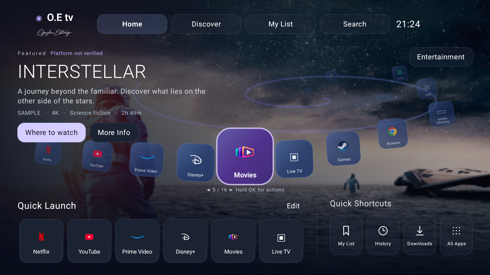

# O.E tv

A cinematic, remote-first Android TV / Google TV launcher built on
[Backdrop Launcher](https://github.com/johnneerdael/Backdrop-Launcher), with a
centred spiral app dock and an editable six-app **Quick Launch** row.

[Türkçe](README.tr.md) · [Quick Launch](docs/development/quick-launch.md) · [Localization](docs/localization.md) · [GPL-3.0-or-later](LICENSE)

All Apps and History use a fullscreen cinematic grid with search, categories,
TV/other-app filters and sorting. History shows each app's last successful
opening through O.E tv, formatted in the app locale and TV time zone.
[Application grid and history](docs/development/apps-grid.md).

Personal edition by Oğuzhan Eklidağ. The home header displays **O.E tv** with
a static handwritten signature beneath it. The Android app label uses the same
name; the existing package identity and Vortex build variant are retained.

The selected app stays at the centre of a lightweight spiral dock and grows to
1.35× size. Installed package icons sit inside glossy rounded tiles. Custom app
rows, Watch Next content, cached backdrops and the original settings remain.

Featured programmes rotate every 30 seconds, keeping artwork, synopsis, platform
and playback link together. Rotation pauses on focused hero actions and open
panels. Wallpaper-only titles offer a viewing-options lookup. Localized summaries
are limited; unknown English synopses show an explicit localized fallback rather
than claiming automatic translation. See [featured content](docs/development/featured-rotation.md).

Quick Launch replaces Continue Watching in the cinematic home's bottom-left
area. Choose up to six installed apps with Edit or long OK; selection order is
row order, and Done/Back saves. Google TV switching remains available. The
classic layout retains the provider-based Watch Next infrastructure. Google TV's
private YouTube continuation cards are not mirrored; this edition adds no
playback collector. See [playback-source limits](docs/development/featured-playback.md).



Compose previews and RTL remote tests cover the supported home locales.

## Languages and accessibility

- Follows the TV/app language; Turkish is not forced.
- Cinematic-home translations: English, Turkish, Spanish, Vietnamese and Arabic.
- Missing translations and other device languages fall back to English per key.
- RTL layouts mirror the spiral and remote directions while keeping the centre fixed.
- System font fallback supports Arabic, CJK and other Unicode scripts.
- Android 13+ per-app language settings, debug pseudolocales and reduced motion.

Legacy settings translations are partial outside English/Turkish. Contributions
are welcome; adding a language does not require modifying Kotlin. See the
[translation scope, resource format and tests](docs/localization.md).

Hero controls stay above the spiral without cutting tile outlines. The
[rendering budget](docs/development/vortex-performance.md) covers the 1080p
artwork cap on 4K displays, bounded image work and interruptible dock animation.

## Build and test

Open `native-launcher/` in Android Studio. Use Java 17+ and Android SDK 36;
Flutter is not needed for the native APK.

```sh
cd native-launcher
./gradlew :app:assembleVortexRelease :app:lintVortexRelease
./gradlew :app:testBenchmarkDebugUnitTest \
  --tests '*UiTextTest' --tests '*LocaleCatalogTest' --tests '*VortexGeometryTest' --tests '*CinemaPerformanceTest' \
  --tests '*ContinueWatchingFeedTest' --tests '*ContinueWatchingTimeTest'
./gradlew :app:testBenchmarkDebugUnitTest \
  --tests '*QuickLaunchTest' --tests '*FeaturedRotationTest' \
  --tests '*AppCatalogTest' --tests '*AppGridNavigationTest'
```

The Home-capable package is `nl.neerdael.backdrop_launcher.vortex` and can coexist
with the upstream launcher. Output: `app/build/outputs/apk/vortex/release/`.
Without explicitly provided signing environment variables it uses a development
key. The upstream self-updater is disabled for this fork. Installation does not
automatically change the television's default Home app.

Use the `benchmarkDebug` variant and an explicitly selected Android TV emulator
for `QuickLaunchUiTest`, `InternationalHomeTest` and `VortexRemoteTest`. The latest
local validation passed 54 focused JVM tests and 29 Android UI checks. A physical
TCL TV check verified favourite persistence, app launch and returning focus;
see [Quick Launch validation](docs/development/quick-launch.md). Test apps, local screenshots,
APK outputs and `.tv-test/` are ignored by Git. The
[Vortex CI workflow](.github/workflows/vortex-checks.yml) validates translations,
lint and builds; it does not publish releases. Upstream publishing workflows are
repository-gated. Physical-TV testing and native-speaker review remain release
acceptance steps; emulator checks are not a TCL frame-rate guarantee.

## Contribute and release

Read [CONTRIBUTING.md](CONTRIBUTING.md) and [docs/localization.md](docs/localization.md).
Keep package/content identities independent of translated labels. Preserve
positional format arguments and plural forms; run catalog and RTL checks.
Keep signing keys/API credentials outside the repository. Publish a release
only after reviewing device behaviour and the [current validation report](docs/development/quick-launch.md).

## Credits and license

Based on Backdrop Launcher by John Neerdael, building on Arc Launcher by Badis
Meddouri, LTvLauncher by LeanBitLab and FLauncher by Étienne Fesser and its
contributors. Existing copyright notices, [CREDITS.md](CREDITS.md) and the
[GNU GPL v3 or later](LICENSE) are retained. Third-party app logos and programme
artwork remain their owners' property; review asset redistribution rights for
your releases. This fork does not claim ownership of those assets.

<details>
<summary>Upstream Backdrop Launcher information</summary>

<picture>
  <source media="(prefers-color-scheme: dark)" srcset="docs/assets/brand/readme-dark.png">
  <source media="(prefers-color-scheme: light)" srcset="docs/assets/brand/readme-light.png">
  
</picture>

<p align="center">
  <a href="https://github.com/johnneerdael/Backdrop-Launcher/releases/latest"></a>
  <a href="https://github.com/johnneerdael/Backdrop-Launcher/actions/workflows/checks.yml"></a>
  <a href="https://backdrop-launcher.neerdael.nl/"></a>
  <a href="LICENSE"></a>
</p>

**A cinematic home for Android TV.** Backdrop Launcher keeps your apps within easy reach and lets your artwork fill the screen. Arrange your own rows, pick up with Continue Watching and make the details yours.

<p align="center">
  <a href="https://github.com/johnneerdael/Backdrop-Launcher/releases/latest/download/backdrop-launcher.apk"><strong>Download APK</strong></a> ·
  <a href="https://backdrop-launcher.neerdael.nl/get-started/install/">Install</a> ·
  <a href="https://backdrop-launcher.neerdael.nl/">User guide</a> ·
  <a href="https://github.com/johnneerdael/Backdrop-Launcher/releases">Release notes</a>
</p>


## Your home, arranged your way

| Capability | What you can do |
| --- | --- |
| **Apps and rows** | Create, reorder, rename and hide rows. Choose their apps and size; hide individual apps globally. |
| **Continue Watching** | Resume programmes shared by compatible TV apps, with playback progress and a spacious two-item carousel. |
| **Cinematic backdrops** | Enjoy ten included offline images, or connect Trakt for trending and anticipated movies/shows and popular public lists. |
| **Personal touches** | Pick app artwork, your accent colour, focus outlines, labels and accent-coloured tile backgrounds with opacity in 10% steps. |
| **A quieter screen** | Customize the date, time and status icons, and choose a moving clock screensaver. |
| **Ready when you return** | Restore cached app artwork, the last wallpaper and Continue Watching at startup. No added branding splash or deliberate wait. |
| **Straightforward updates** | The GitHub build checks this repository for signed releases and can hand the APK to Android’s installer. |

<table>
<tr>
<td width="50%"><br><strong>Pick up where you left off</strong></td>
<td width="50%"><br><strong>Make room for your apps</strong></td>
</tr>
<tr>
<td><br><strong>Choose your app artwork</strong></td>
<td><br><strong>Let the screen breathe</strong></td>
</tr>
</table>

The screenshots above illustrate the earlier Flutter release. The native interface retains these workflows; its implementation and current validation are described in [Kotlin/Compose validation](docs/development/compose-production-validation.md).

The [illustrated user guide](https://backdrop-launcher.neerdael.nl/) walks through every settings page, remote controls, app management, backdrops, clocks and troubleshooting. The [ten-image screenshot pack](marketing/README.md) includes captions and capture provenance.

## Get started

1. Download [`backdrop-launcher.apk`](https://github.com/johnneerdael/Backdrop-Launcher/releases/latest/download/backdrop-launcher.apk) on your Android TV, or transfer it from another device.
2. Allow installation from the app you used to open the APK, then install it.
3. Press Home and choose **Backdrop Launcher** as your home app. Your firmware may offer this choice in its default-app settings.

See [installation and default-home setup](https://backdrop-launcher.neerdael.nl/get-started/install/) for detailed steps and ADB instructions. Backdrop Launcher uses **`nl.neerdael.backdrop_launcher`** and installs separately from earlier Media Launcher test builds.

On Home, **tap Center/Select to open an app** or **hold it to open its actions**. Up/Down switches rows; a faint next-row preview keeps the backdrop visible. In **Settings → Applications**, select a row to move it with Up/Down, then select again to finish. Hold Select or press Right to edit its contents and properties.

Continue Watching depends on your TV’s public Watch Next provider and apps that publish resume items; it has been tested with WuPlay. Some firmware needs an additional TV-listings permission. Trakt is an optional **backdrop source**, with device-code approval on your phone; it does not synchronize viewing history or provide streaming access.

## Build and contribute

The production launcher uses **Kotlin and Jetpack Compose for TV**, Android SDK API **36**, and Java **17 or 21**. Build and test instructions, local API configuration and release signing are documented in [Building Backdrop Launcher](docs/development/building.md) and [Release automation](docs/development/releases.md).

```sh
cd native-launcher
./gradlew :app:testGithubReleaseUnitTest :app:lintGithubRelease :app:assembleGithubRelease
```

The native build retains the production application ID, signing identity and existing launcher data. Historical Dart sources remain as migration references; production APKs contain no Flutter engine. Source copyright notices and the GPL remain intact.

## Credits and licence

Backdrop Launcher is maintained by **John Neerdael**, building on [Arc Launcher](https://github.com/meddouribadis/arclauncher) by Badis Meddouri, [LTvLauncher](https://github.com/LeanBitLab/LtvLauncher) by LeanBitLab and [FLauncher](https://gitlab.com/flauncher/flauncher) by Étienne Fesser and its contributors.

Media metadata and online backdrops come from [TMDB](https://www.themoviedb.org/). This product uses the TMDB API but is not endorsed or certified by TMDB. [Trakt](https://trakt.tv/) supplies optional catalogue selections. Third-party app logos and programme artwork remain the property of their respective owners.

Released under the [GNU GPL v3 or later](LICENSE). See [credits and bundled font licences](CREDITS.md).

</details>
