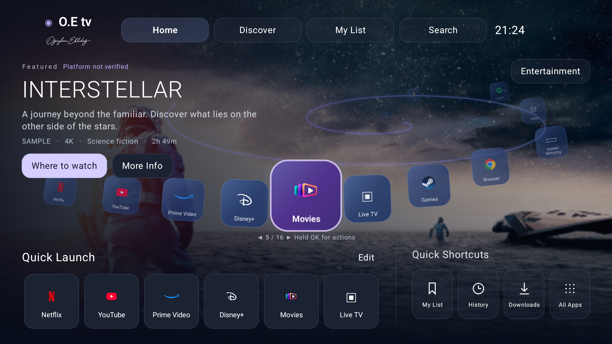

# O.E tv

Öne Çıkan, TV uygulamalarının paylaştığı gerçek içeriklerde platform adını ve
doğrudan içerik bağlantısını gösterir. Bağlantısız arşiv görsellerinde izleme
seçenekleri açılır. Google TV’de görünen özel YouTube devam geçmişi bu TV’nin
ortak medya sağlayıcısında bulunmadığı için otomatik kopyalanamaz. Sinematik
ana ekranın alt bölümü artık Hızlı Başlat’tır; Google TV geçiş düğmesi korunur.
[Platform ve YouTube veri sınırları](docs/development/featured-playback.md).

Backdrop Launcher tabanında, Android TV / Google TV için sinematik bir başlatıcı.
Oğuzhan Eklidağ kişisel sürümü: üst başlıkta **O.E tv**, altında el yazısı imza
yer alır. Android uygulama adı da O.E tv olarak görünür.
Seçili uygulama spiral menünün ortasında kalır ve %135 boyuta büyür. Gerçek
uygulama simgeleri, özel sıralar ve İzlemeye Devam Et altyapısı korunur.

Tüm Uygulamalar ve Geçmiş ekranları; arama, kategori, TV/diğer uygulama filtresi
ve sıralama içeren parlak kart ızgarasını kullanır. Geçmişte O.E tv üzerinden
açılan uygulamaların son ziyaret tarihi ve saati görünür. Eski tarihsiz kayıtlar
ayrıca belirtilir. [Izgara ve geçmiş ayrıntıları](docs/development/apps-grid.md).

**Keşfet** de artık aynı tam ekran düzendedir: içerik kapakları, platform
filtresi, arama, sıralama ve Listem sekmesi bulunur. OK içeriği açar; uzun OK
Listem’e ekler veya çıkarır. [Keşfet ızgarası](docs/development/discover-grid.md).

**Ara** seçeneği de tam ekran kart ızgarası kullanır. Aynı arama metniyle
Uygulamalar ve İçerikler sekmeleri arasında geçilir; kumanda odağı başlangıçta
arama alanındadır. [Arama ekranı](docs/development/search-grid.md).

Yerleşik film arka planlarında görsel, film adı ve kısa açıklama birlikte
değişir. Öne çıkan içerik 30 saniyede bir görseli, açıklaması ve platformuyla
birlikte yenilenir; › düğmesiyle elle de değiştirilebilir. Kumanda hero
düğmelerindeyken otomatik geçiş bekler. Türkçe özetin bulunmadığı tanınan
İngilizce açıklamalarda Türkçe bilgilendirme görünür; genel otomatik çeviri yoktur.

## Hızlı Başlat

Sol altta en fazla altı favori uygulama bulunur. **Düzenle** veya bir kart
üzerinde **uzun OK** ile uygulama seçimini açın. Seçme sırası, kartların sırasını
belirler; **Bitti** veya Geri ile kaydedilir. Gerçek uygulama simgeleri kullanılır.
Bu alan için ek izleme servisi veya erişim izni gerekmez. Klasik arayüzün
İzlemeye Devam Et altyapısı korunur. [Kullanım ve testler](docs/development/quick-launch.md).



## Dil desteği

Uygulama TV'nin dilini veya Android 13+ uygulama dili ayarını izler. Ana ekran
için İngilizce, Türkçe, İspanyolca, Vietnamca ve Arapça çeviriler bulunur. Eksik
çevirilerde İngilizceye dönülür. Diğer dillerde de çalışabilecek altyapı hazırdır;
bu, dünyadaki tüm dillere çevirilerin tamamlandığı anlamına gelmez.

Arapça gibi sağdan sola yazılan dillerde yerleşim ve fiziksel kumanda yönleri
aynanır. Seçili kart yine yatay merkezde kalır. Sistem yazı tipleri farklı alfabe,
CJK ve emoji karakterlerini destekler. Eski ayar ekranlarının İngilizce/Türkçe
dışındaki çevirileri kısmi olduğundan bazı alanlar İngilizce görünebilir.

Yeni diller Kotlin değiştirilmeden Android kaynaklarıyla eklenebilir:
[çeviri ve katkı rehberi](docs/localization.md).

## Derleme

Android Studio'da `native-launcher` klasörünü açın. Java 17+ ve Android SDK 36
kullanın. Flutter gerekmez.

```sh
cd native-launcher
./gradlew :app:assembleVortexRelease :app:lintVortexRelease
```

APK: `app/build/outputs/apk/vortex/release/`. Paket kimliği
`nl.neerdael.backdrop_launcher.vortex` olduğundan orijinal Backdrop ile yan yana
kurulabilir. Kurulum varsayılan ana ekranı kendiliğinden değiştirmez. Üretim
imzalama ayarları verilmezse geliştirme anahtarı kullanılır.

Önce fiziksel TV'de test edin. Emülatör sonuçları gerçek TCL TV'de kare hızı
garantisi değildir. Test çıktıları ve APK'lar yerel `deliverables/` klasöründe
tutulabilir; bu klasör Git'e dahil edilmez. Eklenen Vortex CI iş akışı yalnızca
kontrol ve derleme yapar, yayınlama yapmaz.

Kaynak [GPL v3 veya sonrası](LICENSE) altında kalır. Backdrop, Arc Launcher,
LTvLauncher ve FLauncher atıfları [CREDITS.md](CREDITS.md) içinde korunmuştur.
Üçüncü taraf simge ve içerik görsellerinin hakları sahiplerine aittir.

[English README](README.md) · [Katkı rehberi](CONTRIBUTING.md)
