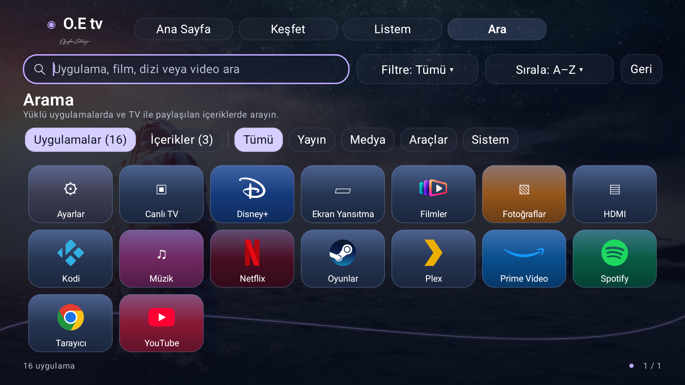

# Fullscreen Search

The top navigation's Search action now opens the same fullscreen catalogue frame
as All Apps and Discover. The initial remote focus is the search field. Press
OK to use the TV keyboard; Down reaches the result-type buttons, then the grid.

- One query is shared between **Applications** and **Content**, with filtered
  counts shown beside each type. Switching type keeps the entered query.
- Applications use the existing seven-column app grid, categories, TV/other-app
  filter and name/recent sorting. OK launches the selected app; hold OK opens its
  existing app actions.
- Content uses Discover's wider artwork cards, platform filter, name/recommended
  ordering, and All/Recommended/My List tabs. OK opens the original programme
  link; missing links show matching metadata. Hold OK toggles My List.
- Up from the field reaches the selected Search navigation tab. Empty results
  leave the input reachable. Returning from an app restores the selected result;
  changing query/filter/sort/type resets the grid to the first result.
- Back leaves the search field and dismisses typing before closing the screen
  on a subsequent Back. This also handles TV keyboards that resize the window
  without reporting IME insets.

Search operates on the installed-app inventory and programmes already shared
with the launcher. It does not query a platform's full online catalogue or
private account history. Typing adds no network requests, background collector,
new permission or dependency. All UI labels have EN/TR/ES/VI/AR resources.

`CinematicSearchScreen` is a thin entry point over the shared private catalogue
engine in `CinematicAppsScreen.kt`. App/content identity, bounded image work and
logical D-pad movement use the existing models and action boundary. The search
field's standard caret is input feedback, not an added full-screen animation.

`SearchScreenTest` covers shared Turkish-normalized queries, separate launch
targets, Select/hold, return focus, the Activity Back dispatcher, RTL empty-state navigation and large-text
previews in five locales. See also [Discover](discover-grid.md).

[Arabic/RTL sample preview](../assets/vortex/search-ar.png). These images use
explicit preview records; they do not show a user's installed-app inventory.

The optimized build was also checked on a TCL / API 30 television: a `youtube`
query returned two installed apps and 12 shared programmes, switching result
types retained the query, and Back dismissed typing without closing Search.
Clearing the query restored the full inventory. Results depend on installed
apps and the content they publish; private YouTube continuation data is not
imported by this screen.
